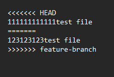

# LR6
Лабораторная работа №6
## Выполнил:
* **Студент:** [Новиков А.А.]
* **Группа:** [4511в]

## Лог выполненных команд 
```bash
git clone https://github.com/D0dikxd/LR6.git
cd LR6
git pull origin master
ls
git branch -a
git log --oneline --graph --all
git log -p
git checkout -b feature-branch
nano test.txt
git add .
git commit -m "Изменения в побочной ветке"
git checkout master
nano test.txt
git add .
git commit -m "Изменения в главной ветке"
git merge feature-branch
git add .
git commit -m "Разрешен конфликт при слиянии"

git branch -d feature-branch
git add .
git commit -m "Первый коммит после слияния"
git add .
git commit -m "Второй коммит с исправлениями"
git log --oneline --graph --all
git reset --soft HEAD~1
git reset --hard HEAD~1
git checkout -b report-branch
git push origin master
git push origin report-branch